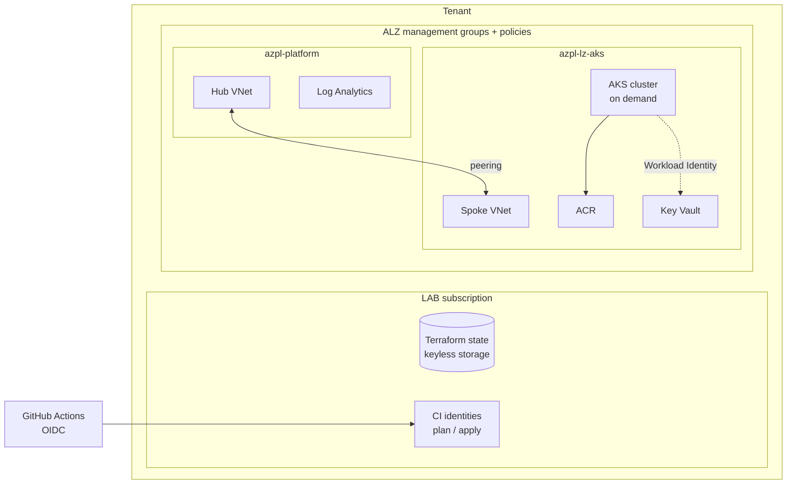

# azure-platform

An Azure platform built the way a client engagement would be: a governed landing zone in
Terraform, an AKS cluster ready for GitOps, then a self-hosted AI inference layer. Everything
goes through pull requests with a reviewed plan, and the expensive parts are created on demand
and destroyed every night.

## The problem

Getting a Kubernetes workload to production on Azure is not about the cluster. It is about what
has to exist before it: a management group hierarchy with policies, identities that need no
stored secrets, a network that can be peered and audited, and a CI/CD path that a reviewer can
trust. Doing that on a personal budget adds a constraint most tutorials ignore: a forgotten
weekend must not cost more than the whole project.

## The approach



| Layer | Path | Content | Lifecycle |
|---|---|---|---|
| Bootstrap | `infra/bootstrap` | Remote state (Entra-only storage account), plan/apply identities federated with GitHub OIDC, global budget | Applied locally, once |
| Landing zone | `infra/landing-zone` | Azure Landing Zones (AVM pattern module, pinned library), subscription vending, FinOps policies, budgets and cost anomaly alerts | Permanent |
| Platform | `infra/platform` | Central Log Analytics, hub VNet | Permanent |
| AKS landing zone | `infra/lz-aks` | Spoke VNet peered to the hub, Key Vault, ACR, teardown identity | Permanent |
| AKS | `infra/aks` | Cluster: OIDC + Workload Identity, Azure RBAC, CNI Overlay with Cilium, Azure Policy add-on | Created by `lab-up`, deleted nightly by `lab-down` |

The common thread is the path of a secret: Key Vault provisioned and governed by policy, read
through Workload Identity with no stored credential, materialised in the cluster by External
Secrets, consumed by the application. No secret is ever committed, at any step.

## Pipeline

```
Pull request  → fmt → validate → tflint → checkov (code + plan) → plan commented on the PR
Merge to main → apply of the permanent layers, protected environment, manual approval
lab-up        → manual, same approval, creates the cluster
lab-down      → every night, deletes the cluster with a least-privilege identity
```

- **No stored credentials in CI.** GitHub OIDC tokens are exchanged for Azure tokens. The
  federated subjects use GitHub's immutable owner and repository IDs, so a renamed or recreated
  repository cannot obtain them.
- **Two identities.** `plan` is read-only and runs pull request code; `apply` only exists in the
  protected `prd` environment. The apply job refuses to run if that environment loses its
  required reviewer.
- **Public logs stay clean.** Identifiers are masked, `[id=...]` lines are stripped from plan
  output, and GUIDs are redacted from PR comments.

## Key decisions and alternatives rejected

- **Azure Verified Modules over home-grown modules** for the landing zone and subscription
  vending: they track Microsoft's reference policies. Both are pinned by Git commit, since the
  lock file only covers providers.
- **Costly ALZ assignments in `DoNotEnforce`** (monitoring agents, backups, Defender plans, DDoS):
  compliance is still evaluated, nothing is deployed until the resources they reference exist.
- **Preventive FinOps over alerts.** Policies deny VM sizes above 4 vCPU (no GPU), high fixed-cost
  resource types (Firewall, Bastion, VPN/ExpressRoute gateways, Application Gateway, NAT Gateway,
  Virtual WAN, DDoS), and resource groups without `owner` / `cost-center`. Budgets and anomaly
  alerts come second: they arrive 8 to 24 hours late.
- **Subscription aliases only live until creation.** Reading an alias requires write access, which
  would break the read-only plan. Subscriptions are then managed by ID, looked up by name.
- **`az aks delete` for the nightly teardown, not `terraform destroy`.** A destroy would need the
  apply identity, hence an approval every night. The teardown identity can only read and delete
  AKS clusters.
- **Free tier, one `Standard_B2s` node, public API server.** A private cluster needs a runner
  inside the VNet; the cluster is protected by Entra ID, Azure RBAC and disabled local accounts.

## Status

- [x] Bootstrap, landing zone, platform, AKS landing zone deployed
- [x] Cluster layer, `lab-up` and `lab-down` in place
- [ ] GitOps with Flux: ingress, cert-manager, External Secrets, Kyverno, KEDA, kube-prometheus-stack
- [ ] Custom Helm chart
- [ ] AI inference layer: KAITO on a spot GPU pool, DCGM metrics, MLflow, APIM AI gateway
- [ ] Drift detection and a daily sweep of billable resources

## Known limits

- Key Vault, ACR and the AKS API are public endpoints (Entra-only access) while CI runs on
  GitHub-hosted runners with dynamic IPs. Private endpoints come with a self-hosted runner.
- MCA billing allows one new subscription per 24 hours.
- The `alz` provider reports that three policies of the Microsoft cloud security benchmark need
  manual role assignments; they are `AuditIfNotExists`, so nothing is deployed in the meantime.

## Getting started

1. **Bootstrap**, from a workstation signed in with MFA: `infra/bootstrap` creates the state
   storage and the CI identities, then migrates its own state to the remote backend.
2. **GitHub configuration**: a `prd` environment with a required reviewer and no admin bypass,
   a `lab` environment restricted to `main`, and the identifiers as Actions secrets.
3. **Everything else goes through pull requests**: open a PR, review the plan comment, merge,
   approve the apply. Run `lab-up` to create the cluster; `lab-down` removes it every night.

Each layer has its own README with the details.
