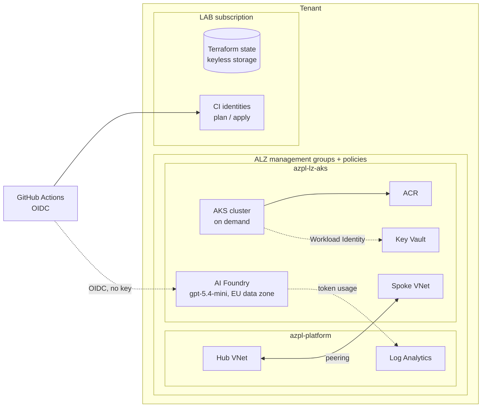
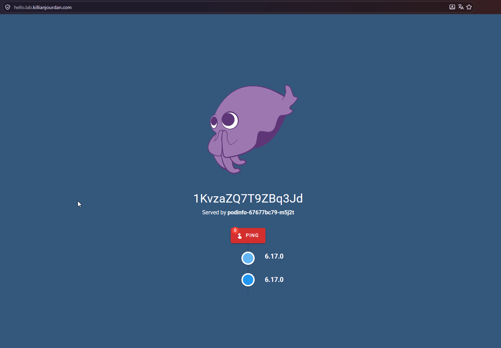
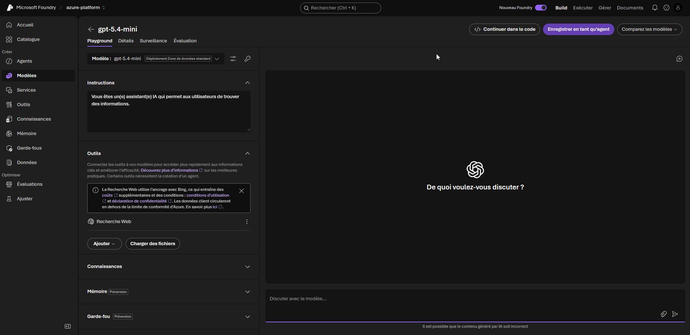
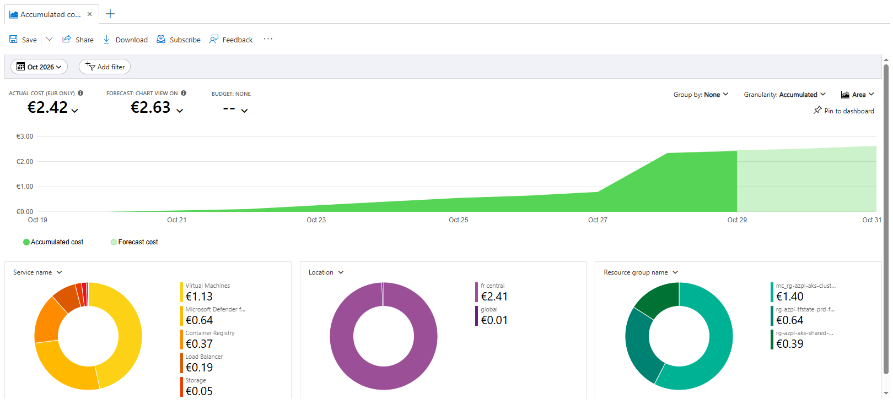

# azure-platform

[](https://github.com/kjourdan1/azure-platform/actions/workflows/lab-down.yml)
[](https://github.com/kjourdan1/azure-platform/actions/workflows/apply-ai.yml)
[](https://github.com/kjourdan1/azure-platform/actions/workflows/ai-smoke.yml)
[](LICENSE)

An Azure platform built the way a client engagement would be: a governed landing zone in
Terraform, an AKS cluster run through GitOps, and keyless Azure AI Foundry foundations.
Everything goes through pull requests with a reviewed plan, and the expensive parts are created
on demand and destroyed every night. **Measured cost: €2.43 for October 2026.**

## The problem

Getting a Kubernetes workload to production on Azure is not about the cluster. It is about what
has to exist before it: a management group hierarchy with policies, identities that need no
stored secrets, a network that can be peered and audited, and a CI/CD path that a reviewer can
trust. Doing that on a personal budget adds a constraint most tutorials ignore: a forgotten
weekend must not cost more than the whole project.

## The approach



| Layer | Path | Content | Lifecycle |
|---|---|---|---|
| Bootstrap | `infra/bootstrap` | Remote state (Entra-only storage account), plan/apply identities federated with GitHub OIDC | Applied by hand, reviewed plan |
| Landing zone | `infra/landing-zone` | Azure Landing Zones (AVM pattern module, pinned library), subscription vending, FinOps policies, budgets and cost anomaly alerts | Permanent |
| Platform | `infra/platform` | Central Log Analytics, hub VNet | Permanent |
| AKS landing zone | `infra/lz-aks` | Spoke VNet peered to the hub, Key Vault, ACR, teardown identity, `lab.killianjourdan.com` DNS zone, controller identities (external-dns, External Secrets) | Permanent |
| AKS | `infra/aks` | Cluster: OIDC + Workload Identity, Azure RBAC, CNI Overlay with Cilium, Azure Policy and KEDA add-ons, Flux extension, federated credentials | Created by `lab-up`, deleted nightly by `lab-down` |
| GitOps | `gitops/` | What Flux reconciles, in three ordered levels: platform controllers, their configurations, hosted apps | Reapplied by Flux on every `lab-up` |
| AI | `infra/ai` | Azure AI Foundry account and project, `gpt-5.4-mini` in the EU data zone, no API keys (Entra only), diagnostics to central Log Analytics | Permanent (no fixed cost) |
| Web landing zone | `infra/lz-web` | Subscription `azpl-lz-web` under `online`, landing the portfolio site taken over from the standalone `LAB` subscription (brownfield runbook) | Permanent |

The common thread is the path of a secret: Key Vault provisioned and governed by policy, read
through Workload Identity with no stored credential, materialised in the cluster by External
Secrets, consumed by the application. No secret is ever committed, at any step.

## Evidence

Nothing here asks to be taken on trust. Each claim points to something public and dated.

| Claim | Evidence |
|---|---|
| Foundry answers with no API key (GitHub OIDC → Entra → model) | [`ai-smoke` run](https://github.com/kjourdan1/azure-platform/actions/workflows/ai-smoke.yml): answer and token usage in the run summary |
| Infrastructure changes are reviewed before being applied | Pull requests carry the `terraform plan` as a comment, e.g. [the Foundry layer](https://github.com/kjourdan1/azure-platform/pull/20) (9 to add) |
| Applies go through a protected environment | [`apply-ai`](https://github.com/kjourdan1/azure-platform/actions/workflows/apply-ai.yml), [`apply-landing-zone`](https://github.com/kjourdan1/azure-platform/actions/workflows/apply-landing-zone.yml) runs, each approved |
| The cluster does not survive the night | [`lab-down`](https://github.com/kjourdan1/azure-platform/actions/workflows/lab-down.yml), scheduled every evening |
| A cluster rebuilt from Git serves HTTPS with a value that round-trips through Key Vault | https://hello.lab.killianjourdan.com, online only while the lab is up (`lab-up`) |
| Manifests are validated against the cluster's admission rules before merge | [`gitops-pr`](https://github.com/kjourdan1/azure-platform/actions/workflows/gitops-pr.yml): CRD schemas and the ALZ Gatekeeper rule on every rendered chart |





### Measured cost

Actual cost from Azure Cost Management, October 1–29, 2026, all subscriptions:

| Subscription | Item | Cost |
|---|---|---|
| `azpl-lz-aks` | AKS nodes (only while the lab is up) | €1.13 |
| | Container Registry (Basic) | €0.37 |
| | Load balancer | €0.19 |
| | Storage, network, DNS, Key Vault | €0.10 |
| `LAB` | Microsoft Defender for Cloud | €0.64 |
| `azpl-platform` | Hub VNet, Log Analytics | €0.00 |
| **Total** | | **€2.43** |

Foundry has no fixed cost: the account, project and Standard deployment bill per token only.



## Pipeline

```
Pull request  → fmt → validate → tflint → checkov (code + plan) → plan commented on the PR
Merge to main → apply-<stack> for each changed permanent layer only, protected environment, manual approval
lab-up        → manual, same approval, creates the cluster
lab-down      → every night, deletes the cluster with a least-privilege identity
```

- **No stored credentials in CI.** GitHub OIDC tokens are exchanged for Azure tokens. The
  federated subjects use GitHub's immutable owner and repository IDs, so a renamed or recreated
  repository cannot obtain them.
- **One pipeline per stack.** Each permanent layer has its own `apply-<stack>` workflow,
  triggered only by changes under `infra/<stack>`; they share one reusable job carrying the
  guardrails. A merge no longer applies, and asks approval for, layers it did not touch. A PR
  that changes two dependent layers is applied in dependency order by running the second
  workflow after the first.
- **Two identities.** `plan` is read-only and runs pull request code; `apply` only exists in the
  protected `prd` environment. The apply job refuses to run if that environment loses its
  required reviewer.
- **Public logs stay clean.** Identifiers are masked, `[id=...]` lines are stripped from plan
  output, and GUIDs are redacted from PR comments.

## Key decisions and alternatives rejected

- **Azure Verified Modules over home-grown modules** for the landing zone and subscription
  vending: they track Microsoft's reference policies. Both are pinned by Git commit, since the
  lock file only covers providers.
- **Costly ALZ assignments in `DoNotEnforce`** (monitoring agents, backups, Defender plans, DDoS):
  compliance is still evaluated, nothing is deployed until the resources they reference exist.
- **Preventive FinOps over alerts.** Policies deny VM sizes above 4 vCPU (no GPU), high fixed-cost
  resource types (Firewall, Bastion, VPN/ExpressRoute gateways, Application Gateway, NAT Gateway,
  Virtual WAN, DDoS), and resource groups without `owner` / `cost-center`. Budgets and anomaly
  alerts come second: they arrive 8 to 24 hours late.
- **Subscription aliases only live until creation.** Reading an alias requires write access, which
  would break the read-only plan. Subscriptions are then managed by ID, looked up by name.
- **`az aks delete` for the nightly teardown, not `terraform destroy`.** A destroy would need the
  apply identity, hence an approval every night. The teardown identity can only read and delete
  AKS clusters.
- **Flux as the AKS extension, not `flux bootstrap` or Argo CD.** Bootstrap needs a GitHub token
  with write access stored somewhere; the extension reads this public repository anonymously and
  arrives with the cluster in the same apply. Argo CD is more widespread but sits outside the
  native AKS integration and adds a UI to secure.
- **Environment values injected by Flux post-build substitution.** Tenant, subscription, DNS zone
  and client IDs never enter Git; a CI check rejects any `${VAR}` that Terraform does not provide,
  since Flux would silently replace it with an empty string.
- **Free tier, one `Standard_D4as_v7` node, public API server.** A private cluster needs a runner
  inside the VNet; the cluster is protected by Entra ID, Azure RBAC and disabled local accounts.

## Status

- [x] Bootstrap, landing zone, platform, AKS landing zone deployed
- [x] Cluster layer, `lab-up` and `lab-down` in place
- [x] GitOps foundation: Flux extension, three ordered levels, manifest validation on PRs
- [x] Ingress and secrets: Gateway API (Envoy Gateway), cert-manager, external-dns, External Secrets; demo page whose content round-trips through Key Vault
- [ ] Observability and governance: kube-prometheus-stack, Kyverno
- [ ] Hosted app: AKS Store Demo, KEDA scaling on its order queue
- [ ] Custom Helm chart
- [x] AI foundations: Azure AI Foundry with a pinned model deployment, keyless access, token usage logged; `ai-smoke` workflow proves it end to end
- [ ] Enterprise AI assistant on top of it: RAG, MCP tools with the user's identity, guardrails, caching and routing, evals in CI
- [ ] Brownfield takeover of the standalone `LAB` subscription into the landing zone: inventory, a new `online` subscription for the portfolio, move, Terraform import, `LAB` under `management` ([runbook](docs/runbooks/brownfield-lab.md))
- [ ] Drift detection and a daily sweep of billable resources

## Known limits

- Key Vault, ACR and the AKS API are public endpoints (Entra-only access) while CI runs on
  GitHub-hosted runners with dynamic IPs. Private endpoints come with a self-hosted runner.
- MCA billing allows one new subscription per 24 hours.
- `infra/bootstrap` is ahead of its state: the global budget, the cost anomaly alert, the GitHub
  environment management and the subscription-level Contributor assignments are in code but were
  never applied (GitHub settings are managed by hand). Per-subscription budgets from the landing
  zone are in place. Reconciling this, import or removal, is a dedicated task.
- The `alz` provider reports that three policies of the Microsoft cloud security benchmark need
  manual role assignments; they are `AuditIfNotExists`, so nothing is deployed in the meantime.

## Getting started

1. **Bootstrap**, from a workstation signed in with MFA: `infra/bootstrap` creates the state
   storage and the CI identities, then migrates its own state to the remote backend.
2. **GitHub configuration**: a `prd` environment with a required reviewer and no admin bypass,
   a `lab` environment restricted to `main`, and the identifiers as Actions secrets.
3. **Everything else goes through pull requests**: open a PR, review the plan comment, merge,
   approve the apply. Run `lab-up` to create the cluster; `lab-down` removes it every night.

Each layer has its own README with the details.
